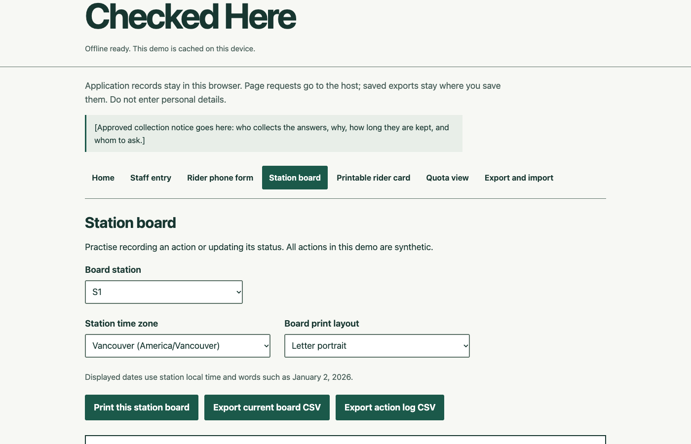
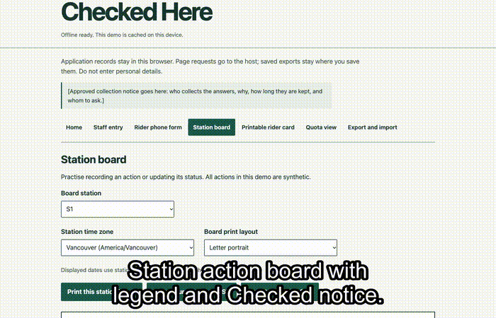
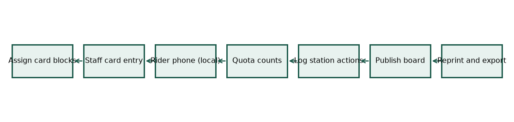
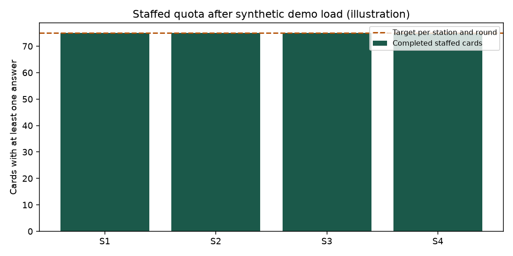
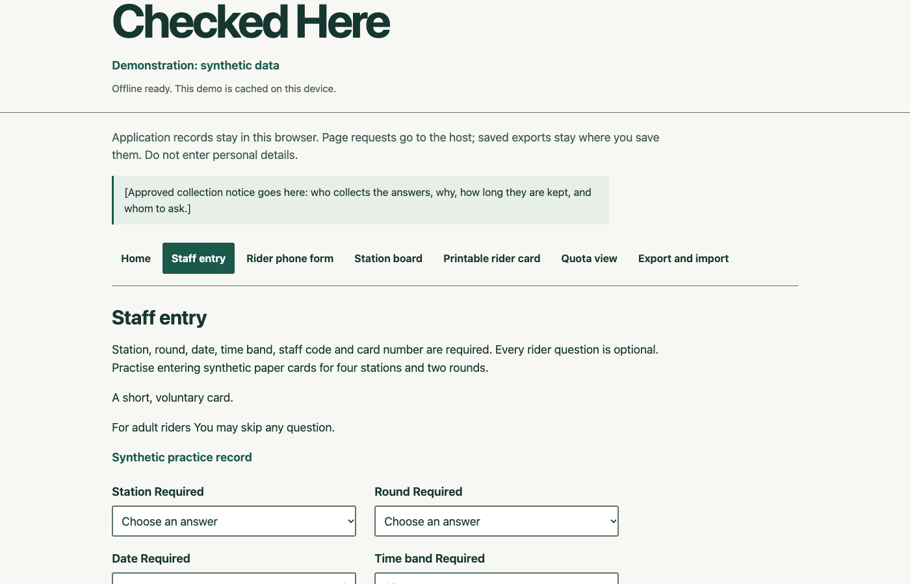
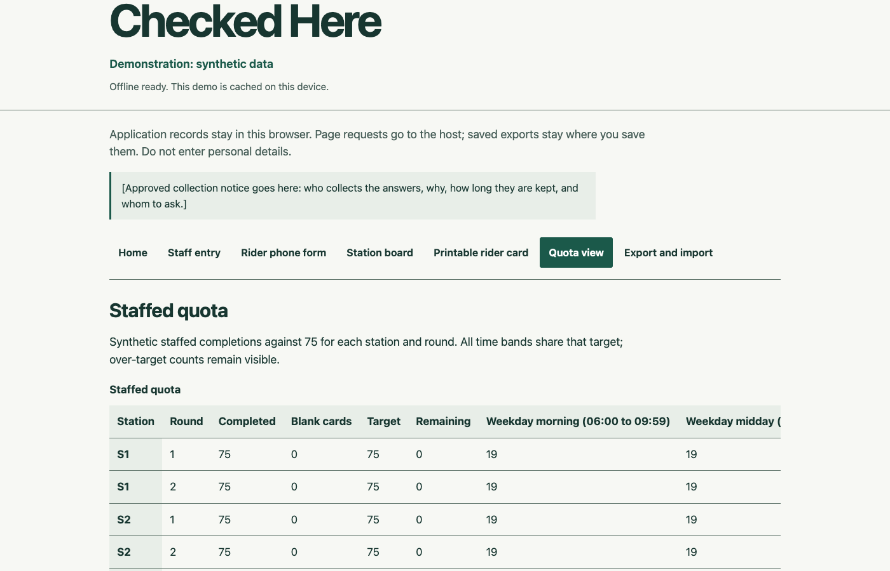
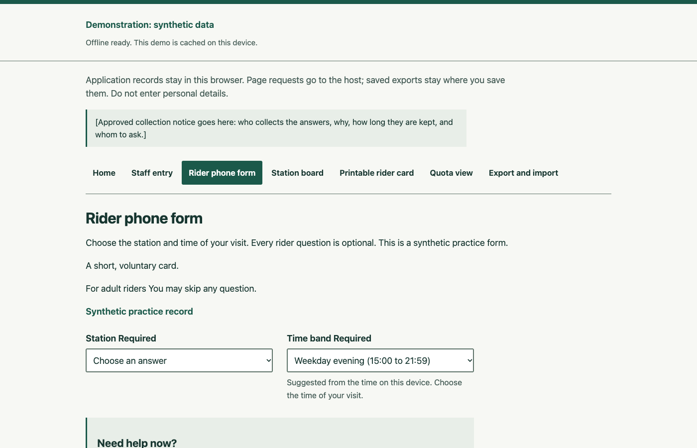
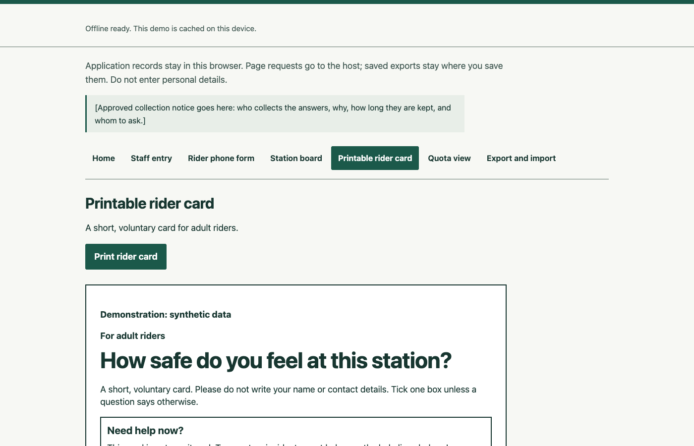
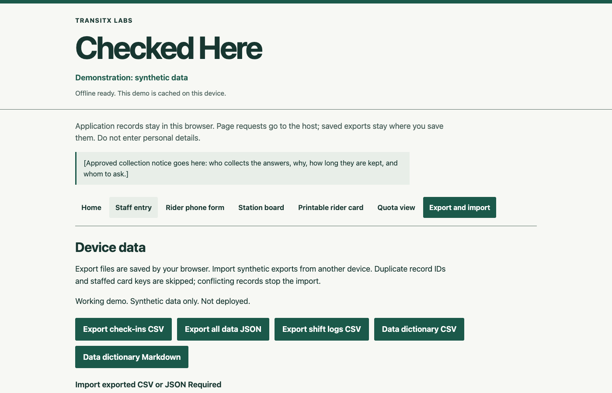
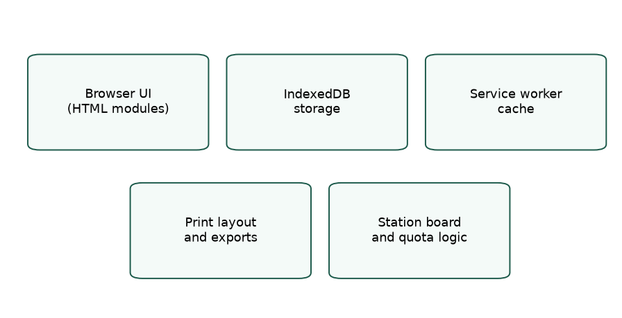

# Checked Here

Checked Here is a working demonstration by TransitX Labs Inc. It shows how station staff could collect rider cards, log station actions and post a board of what was planned, checked or not done. It includes a rider phone form, quota counts and exports. All records are synthetic. It is not approved for real use.

**[Try it live](https://transitxlabs.github.io/checked-here/)** (static HTML, no install). See `docs/PAGES_TODO.md` for Pages media notes.

Captions: `docs/media/demo.en.vtt`. Checked means staff verified this action on site. It is not a safety rating.

| Example views (synthetic data) | |
| --- | --- |
|  |  |
|  |  |
|  |  |

### How it works

1. A collection lead gives each collector a non-overlapping numbered block of rider cards.
2. Staff enter each card's answers; riders may skip any question.
3. Riders may also answer on the phone form; those answers stay in the rider's browser and never reach staff devices or the staff quota.
4. The quota view counts staffed cards with at least one rider answer as completed, against 75 per station and round.
5. Staff log each station action as Planned, Checked or Not done, with a status date; Not done needs a reason.
6. The Station action board opens with the status legend and the Checked notice; staff must mark unsafe or sensitive actions withheld, and those stay off the board.
7. After every board update, reprint the whole set as numbered sheets of one print revision, check that Sheet x of y runs complete, remove the older set, and export CSV or JSON files.

### Architecture

Static HTML, CSS and JavaScript modules in the browser; records in IndexedDB; a service worker caches application assets for offline use. Board printing and exports use dedicated layout modules (`js/board.mjs`, `js/print-layout.mjs`, `js/storage.mjs`).

### Design choices

- **Local-only records:** answers and action logs stay in the browser; transfers are manual exports and imports, with no hosted collection API.
- **Separate phone path:** rider phone answers never count toward the staffed quota or reach staff devices.
- **Withheld actions:** unsafe or sensitive items stay in the staff log but are excluded from the public board and its CSV.
- **Explicit Checked meaning:** the board notice states that Checked is an on-site staff mark, not a safety rating or proof that work happened.

### Why it matters

Riders would see what staff marked Checked at their station; the board never claims the station is safe.

To regenerate showcase screenshots, charts and the local demo recording, run `python3 scripts/make_showcase_media.py` (Playwright, matplotlib and ffmpeg required). Large video output is written to `showcase-media/demo.mp4` and is not committed.

## Run locally or as a static site

Run `python3 -m http.server 8913 --bind 127.0.0.1` in this folder and open `http://127.0.0.1:8913/`. Plain HTML, CSS and JavaScript modules need no framework, build step, installation, external font or CDN. Service workers require localhost or HTTPS; opening the file directly is unsupported. GitHub Pages can serve this folder directly, including under a repository subpath. The demonstration is served by GitHub Pages from this repository; no other deployment is part of this work.

Wait for **Offline ready** before disconnecting. The worker caches published application assets in `transitx-checkin-v1.2.1`, removes older application caches and serves cached files without a runtime network fallback. During an update, preparation waits for the new worker to control the page before checking the new cache, and checks a missing cache entry once more before reporting an error. Preparation reports an error after an installation failure or 15 seconds without a result. Keep the same browser, origin and port to retain records.

## Explore

**Load synthetic demo** adds 600 staffed cards, 8 self-selected rider-phone records, 8 shifts and 20 events for 12 actions across four placeholder stations and two rounds. Dates are relative to the load date and identifiers stay stable. Repeating the load on the same date skips duplicates. Loading a fresh dated example into an older example's identifiers reports a conflict; export and clear the old demonstration first. Nothing is silently overwritten.

**Staff entry** is for adult-rider practice cards. Station, round, date, time band, distribution staff code and card number are visibly marked required. Every rider question may be skipped, including all of question 2. Staff must not invent answers. Dates cannot be in the future. Saving keeps station, round, date, time band and staff code, clears answers, advances the card number by one and focuses that number. A separate shift log records asks and refusals, with refusals no greater than asks.

A collection lead keeps one allocation register for each station and round and assigns non-overlapping numbered blocks to collectors before cards are issued. Each collector uses only their allocated block; two collectors cannot issue the same station, round and card number. Never share or reissue numbers, including on separate devices. Save unreadable or conflicting marks as no answer, never guess: use null for a scalar question, and no ticks for question 2. A blank card is saved using its recorded context.

Time bands are demonstration placeholders to be set with the transit agency in Month 1: weekday morning 06:00 to 09:59, weekday midday 10:00 to 14:59, weekday evening 15:00 to 21:59, and weekend 06:00 to 21:59. The hours appear on screen as well.

**Rider phone form** keeps self-selected synthetic answers outside the staffed quota. `?s=S2` preselects a station. The phone route uses rider wording and suggests the time band from the device clock within the displayed collection hours. Phone answers stay in the browser that took them. They never reach staff devices or the staff quota. There is no shared backend or automatic transfer.

The printable card and both forms share the same six-question source. Riders may skip any question. Question 2 permits up to three ticks, or none. Question 3 is a prompted, looking-back answer about help awareness before today, given after the card help box. It is not unaided prior awareness. Question 4 names the **Station action board** and distinguishes reading it from seeing it without reading it. Questions 5 and 6 apply only after **Yes, and I read it**, and remain optional. Switching to another answer clears them. The 1 to 10 safety scale and 1 to 5 trust scale remain. The card is for adult riders, provides an unmonitored-card warning and unfinished help-line and collection-notice placeholders, and keeps the distribution staff code in a labelled staff-only box.

**Quota view** counts only staffed cards with at least one rider answer as completed against 75 per station and round. Entirely blank cards are saved and counted separately, without reducing the remaining target. Time bands share the target. Self-selected rider-phone records and shift totals are separate.

**Station action board** is the short name shown on the board itself and in question 4. The full status legend and Checked notice precede the first action on screen. Counts cover the whole board. Every line shows its status date. Only Planned lines show a due date, labelled "Due by". Checked lines show no due date. Not done lines show their reason and no due date. A reason is required for Not done and optional for Planned and Checked, labelled "Why:" on the public board. Checked means staff verified the action on site; it does not mean the problem is solved or the station is safe. Actions appear newest first by their shown status date, regardless of status; entry time breaks ties. The board Updated header uses the newest shown status date. Legacy events without a separate status date use the date of their stored timestamp. Unsafe or sensitive actions must be marked withheld; withheld actions remain in the staff log and are excluded from the public board and its CSV. Due dates and unresolved reasons require approval by the agency before real use.

The status date is the staff-entered date of the on-site check or update, defaulting to today. Staff history separately labels **Status date** and **Recorded at**. The log's `updated_at` records when the event was entered; `event_number` orders rechecks entered at the same instant. A same-status recheck appends another event. Station, title and concern cannot be corrected after creation in this demonstration. Status-history events cannot be edited or deleted. A new status event may correct its status details, but cannot supersede its title or concern text. A title or concern correction event is unavailable in this demonstration. Prior snapshots remain in the log.

`?board=S1` opens a read-only phone board with no navigation, staff entry or exports. It shows local records, or a clearly marked synthetic example when the browser has no action log. It does not fetch another device's board. Reprint the station poster after every board update. After any change, staff replace and check the whole matching set. Check every sheet has the same print revision and that Sheet x of y labels form a complete sequence; remove the older set from display.

## Printing and dates

Select Letter portrait or Tabloid landscape in the board view. Complete actions are packed onto each sheet using their printed heights. Each sheet carries station context, the legend once, the exact Checked notice once in its footer, counts labelled as covering the whole board, and **Sheet x of y**. The set shares one print revision: the newest status date plus a short code derived from the board content. Display all matching sheets together as the Station action board. Tabloid status and action-title text are at least 28 pt, all other board text is at least 18 pt, and the footer notice and rider invitation are at least 24 pt. Letter board text is at least 18 pt. The compact Tabloid heading lets the first action begin in the top third of the sheet. No viewing distance is claimed.

The rider card uses both sides of one Letter sheet. Print the two pages double-sided. Rider-facing text is at least 12 pt, including instructions, help, collection notice and scale anchors. Administration and version text follow the staff box.

Word dates use **January 2, 2026** and times use **2:30 p.m.** Board posters show dates only and no zone identifiers. The staff log uses station-local dates and times. Vancouver retains the existing year-round Pacific Time handling: UTC-7 from March 8, 2026 onward, without a November fall back. Other listed zones use the installed time-zone database. CSV timestamps retain ISO 8601 with an explicit station offset; imports restore the stored canonical instant.

## Records, privacy and manual transfers

Application records stay in this browser's IndexedDB. The application does not transmit answers or action records, and has no analytics, submission endpoint, tracking or remote backup. Page and static-file requests still reach the site host; the host may retain request logs. This statement about application records does not describe the host's logging policy.

Explicit exports create files outside the browser database. Saved exports remain wherever the user or browser puts them, may be copied separately and are not erased by clearing this application. Transfers between browsers are manual demonstration exports followed by file imports; there is no live collection or synchronization service. Browser clearing, storage eviction or private browsing can remove records. There is no application-level encryption.

Downloads include `checkins.csv`, `shifts.csv`, selected `board-S1.csv`, `action-log-S1.csv`, complete `device-data.json`, and the data dictionary. Blank scalar answers are null in JSON and empty in CSV. Zero question-2 ticks mean no recorded answer: the ten reason columns are empty. On answered question-2 rows the columns are 0 or 1. Legacy all-zero reason rows remain importable. The dictionary defines every field and blank value.

Check-in, shift and action-log CSV and complete JSON bundles can be imported manually. Current-board CSV is a presentation export; use the action log to preserve history. Only synthetic records are accepted. Exact duplicate identifiers and equivalent staffed card keys are skipped; conflicting records stop the entire import before writing. Earlier bundles and action snapshots remain supported. Existing stored records are not silently rewritten.

To clear records, export all data as JSON in the current session and verify the downloaded file, then choose **Clear this device after export**, tick the confirmation and confirm. A second transaction check prevents erasing a changed snapshot. This clears all three datasets, including withheld history, while retaining downloads and the offline cache.

## Local verification and accessibility

Set `TMPDIR` to a scratch folder and `EVIDENCE_DIR` to an evidence folder; without them the scripts use `.work/tmp` and `.work/evidence` in this repository, which git ignores. Run `node scripts/run-faults.mjs --v121` followed by `node --test`. The fault runner plants a separate semantic fault for each named test in a disposable local copy and requires that test to fail before the retained passing suite. Syntax-only failures do not count. Existing test identifiers and applicable coverage remain, with revised optional-answer and board-order contracts.

Automatic accessibility results mean **no violations detected automatically in the tested states**. They are not an accessibility conformance certification. Browser checks cover all routes at 320, 768 and 1280 px in light and dark schemes, accessible control names and local automatic scans. Manual-script checks cover keyboard operation, visible focus, skip and error links, focus after save/export/import, conditional questions, blank cards, the phone board, colour contrast, print reading order and type sizes, and reloads with the local server stopped. These checks do not replace review with people using assistive technology.

Use existing local software only. To repeat browser checks, set `BROWSER_LIBRARY` to an installed browser automation module and `AXE_LIBRARY` to a local scanner file, then run `node scripts/browser-checks.mjs`. `CHROME_EXECUTABLE` may select an existing Chrome executable. `python3 scripts/print-checks.py` inspects generated PDFs using the existing local PDF reader. The harness blocks external requests and closes its browser and loopback server. Before every browser or print run, it checks `df -g /` and stops below 49 GB free. It writes this round's evidence to `EVIDENCE_DIR` (default `.work/evidence`) and logs to `LOG_DIR` (default `.work/logs`); earlier evidence remains in place. Temporary files and browser profiles use `TMPDIR` (default `.work/tmp`). Set `ROOT_SOURCE_COMMIT` to the final commit for final checks.

The final source commit is recorded before generating final PDFs. Any later source change requires a new commit and the complete final fault, passing-test, browser, upgrade, contrast and PDF checks again. Superseded runs are retained as intermediate evidence outside the repository. Refreshed evidence, `BUILD_REPORT.md` and `SHA256SUMS` remain uncommitted. They record that SHA and verify that tracked source bytes are unchanged. Earlier evidence remains intact. The manifest covers the payload, earlier evidence, new evidence at the external path and report and excludes itself.

Display strings live in `js/locales/en.mjs`; page language comes from the locale. The second locale contains matching pending keys for development and is excluded from the offline cache. Approved translations, help lines, collection notice and further review are required for real use.

## Open by design

Code licence: Apache-2.0 (see `LICENSE`). The plain HTML, CSS and JavaScript modules can be inspected and reused locally. This demonstration is not approved or ready for real collection or deployment.
